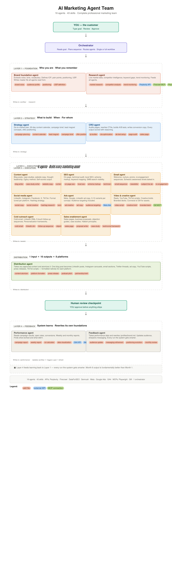

# AI Marketing Agent Team

> Hệ thống tự động hoá marketing bằng AI cho doanh nghiệp Việt Nam — 16 agents, 76 skills, chạy được trên cả **Claude Code** và **Hermes Agent**.

Thay vì thuê cả phòng marketing, bạn có một đội AI chuyên trách: chiến lược thương hiệu, nghiên cứu thị trường, lập kế hoạch chiến dịch, sản xuất nội dung/SEO/email/social/ads/video, outreach, phân phối, đo lường hiệu quả và tự cải tiến theo dữ liệu.

```
Bạn gõ một mục tiêu bằng ngôn ngữ tự nhiên
        ↓
Orchestrator đọc brand.md, kiểm tra trạng thái hệ thống, định tuyến đúng agent
        ↓
Agent chạy skill tương ứng, tạo output
        ↓
Output lưu vào outputs/ chờ bạn duyệt
        ↓
Bạn duyệt → mới xuất bản. Hệ thống đề xuất — con người quyết định.
```

Mỗi tháng, Feedback Agent đọc dữ liệu hiệu quả và viết lại nền tảng thương hiệu — nên output tháng 6 tốt hơn hẳn tháng 1.

---

## Mục lục

- [Kiến trúc hệ thống](#kiến-trúc-hệ-thống)
- [16 Agents](#16-agents)
- [76 Skills](#76-skills)
- [Nguyên tắc thiết kế](#nguyên-tắc-thiết-kế)
- [Cấu trúc thư mục](#cấu-trúc-thư-mục)
- [Cài đặt — Hermes Agent (khuyến nghị)](#cài-đặt--hermes-agent-khuyến-nghị)
- [Cài đặt — Claude Code](#cài-đặt--claude-code)
- [API keys & tích hợp ngoài](#api-keys--tích-hợp-ngoài)
- [Cách sử dụng](#cách-sử-dụng)
- [Quy trình làm việc](#quy-trình-làm-việc)
- [Chuyển đổi Claude → Hermes](#chuyển-đổi-claude--hermes)
- [Tài liệu](#tài-liệu)
- [Lưu ý bảo mật](#lưu-ý-bảo-mật)
- [License](#license)

---

## Kiến trúc hệ thống

16 agents (1 orchestrator + 15 agent chuyên trách) tổ chức thành 4 lớp:

| Lớp | Agents | Vai trò |
|---|---|---|
| **L1 — Foundation** | Brand Foundation, Research | Xây master context (`brand.md`); lấy dữ liệu thị trường trực tiếp |
| **L2 — Strategy** | Strategy, CRO | Lập kế hoạch chiến dịch; tối ưu chuyển đổi |
| **L3 — Execution** | Content, SEO, Email, Social, Ads, Video & Creative, Cold Outreach, Sales Enablement, Distribution | Sản xuất toàn bộ tài sản marketing |
| **L4 — Feedback** | Performance, Feedback | Đọc kết quả; viết lại nền tảng L1 |
| **—** | Orchestrator | Định tuyến yêu cầu; ép thứ tự workflow |

**Thứ tự workflow bắt buộc:**

```
Foundation → Research → Strategy → CRO → Execution → Distribution → Review → Feedback
```

Orchestrator cũng hỗ trợ **single-agent mode** — ví dụ "viết cho tôi một bài blog" sẽ đi thẳng tới Content Agent, bỏ qua toàn bộ workflow.



---

## 16 Agents

Giải thích chi tiết từng agent nằm trong [`agent-explain/`](agent-explain/).

| # | Agent | Lớp | Nhiệm vụ | Skills |
|---|---|---|---|---|
| — | Orchestrator | Điều phối | Định tuyến, kiểm tra trạng thái, ép thứ tự workflow | 1 |
| 01 | Brand Foundation | L1 | Xây `brand.md` — 12 sections: voice, audience, positioning, USP | 5 |
| 02 | Research | L1 | Market research, đối thủ, từ khoá, xu hướng (dữ liệu live) | 4 |
| 03 | Strategy | L2 | Campaign planning, content calendar, lead magnet, brief | 5 |
| 04 | CRO | L2 | Landing page, CTA, A/B test, page audit, sales page | 5 |
| 05 | Content | L3 | Blog, case study, website copy, content brief, thought leadership | 5 |
| 06 | SEO | L3 | Keyword, on-page, local, schema, technical audit, link building | 6 |
| 07 | Email | L3 | Email sequence, newsletter, subject-line A/B, re-engagement | 5 |
| 08 | Social | L3 | Social copy/creative, hashtag, calendar, community, video script | 6 |
| 09 | Ads | L3 | Ad copy/creative, targeting, campaign structure, PMax brief | 6 |
| 10 | Video & Creative | L3 | Video script, creative brief, branded deck, UGC script | 4 |
| 11 | Cold Outreach | L3 | Cold email, LinkedIn DM, follow-up, objection handling | 5 |
| 12 | Sales Enablement | L3 | Sales page, proposal, case study, testimonial | 5 |
| 13 | Distribution | L3 | Content atomizer, platform formatter, press release, podcast pitch | 5 |
| 14 | Performance | L4 | Campaign/weekly report, ROI, data viz, monthly review | 5 |
| 15 | Feedback | L4 | Audience update, messaging refinement, positioning evolution | 4 |

---

## 76 Skills

Mỗi skill là một lệnh gọi trực tiếp (Hermes: `/tên-skill`, Claude Code: agent tương ứng). Danh sách theo nhóm:

**Brand Foundation (5):** `brand-setup` · `brand-voice` · `audience-profile` · `positioning` · `usp-definition`
**Research (4):** `market-research` · `competitor-analysis` · `keyword-research` · `trend-monitoring`
**Strategy (5):** `campaign-planning` · `content-calendar` · `lead-magnet` · `campaign-brief` · `offer-positioning`
**CRO (5):** `lp-builder` · `cta-optimization` · `cro-ab-test-setup` · `page-audit` · `cro-sales-page`
**Content (5):** `content-brief` · `blog-writer` · `case-study-writer` · `website-copy` · `thought-leadership`
**SEO (6):** `seo-keyword-research` · `on-page-seo` · `local-seo` · `schema-markup` · `technical-seo-audit` · `link-building-strategy`
**Email (5):** `email-sequence` · `newsletter` · `subject-line-ab` · `re-engagement` · `transactional-email`
**Social (6):** `social-copy` · `social-creative` · `hashtag-research` · `social-calendar` · `community-management` · `social-video-script`
**Ads (6):** `ad-creative` · `ad-copy` · `audience-targeting` · `ad-campaign-structure` · `ads-ab-test-setup` · `google-pmax-brief`
**Video & Creative (4):** `video-script` · `video-creative-brief` · `branded-deck` · `ugc-script`
**Cold Outreach (5):** `cold-email` · `linkedin-dm` · `follow-up-sequence` · `outreach-objection-handler` · `personalization-framework`
**Sales (5):** `sales-page-writer` · `proposal-writer` · `sales-objection-handler` · `sales-case-study` · `testimonial-framework`
**Distribution (5):** `content-atomizer` · `platform-formatter` · `press-release` · `podcast-pitch` · `partnership-brief`
**Performance (5):** `campaign-report` · `weekly-report` · `roi-calculator` · `data-visualization` · `performance-monthly-review`
**Feedback (4):** `audience-update` · `messaging-refinement` · `positioning-evolution` · `feedback-monthly-review`
**Điều phối (1):** `marketing-orchestrator`

> Một số tên có tiền tố (`seo-keyword-research`, `cro-ab-test-setup`...) để tránh trùng tên giữa các nhóm — chuẩn đặt tên duy nhất của Hermes.

---

## Nguyên tắc thiết kế

1. **`outputs/profiles-output/brand.md` là nguồn sự thật duy nhất.** Không agent nào chạy trước khi file này tồn tại. Mọi skill đọc nó trước khi thực thi.
2. **Đường dẫn I/O cố định.** Mọi skill đọc/ghi theo path dự đoán trước, để skill sau trong chuỗi dùng ngay output của skill trước mà không cần biến đổi.
3. **Human review checkpoint.** Mọi output đều nằm trong thư mục chờ duyệt trước khi xuất bản.
4. **Xây orchestrator cuối cùng**, nhưng thiết kế mọi skill tương thích orchestrator ngay từ đầu.
5. **Vòng feedback khép kín.** Lớp 4 viết lại nền tảng lớp 1 — hệ thống tự tốt lên theo thời gian.

---

## Cấu trúc thư mục

```
general-service/
├── README.md                  ← file này
├── CLAUDE.md                  ← hướng dẫn cho Claude Code
├── GUIDE.md                   ← user guide đầy đủ (setup API/MCP, troubleshooting)
├── docs/                      ← bản thiết kế hệ thống (blueprint)
│   ├── ai-marketing-agent-team.md / .pdf
│   └── brand-foundation-diagram.html
├── agent-explain/             ← giải thích chi tiết 16 agents
├── diagram/                   ← sơ đồ kiến trúc & workflow (PNG/PDF)
│
├── .claude/                   ← BẢN CLAUDE CODE (nguồn gốc)
│   ├── agents/                ← 16 agent definitions
│   └── commands/              ← 75 command skills theo 15 nhóm
│       └── 01-brand-foundation/references/brand-md-schema.md
│
├── hermes-skills/             ← BẢN HERMES AGENT (đã chuyển đổi)
│   ├── README.md              ← hướng dẫn bản Hermes
│   ├── convert.py             ← script chuyển đổi .claude/ → Hermes
│   ├── install.sh             ← script cài vào ~/.hermes/skills/
│   └── marketing/             ← category chứa 76 skills
│       ├── DESCRIPTION.md
│       └── <skill>/SKILL.md (+ references/ nếu có)
│
└── outputs/                   ← (tạo khi chạy, đã gitignore) toàn bộ output
    ├── profiles-output/brand.md   ← master file — mọi agent đọc đầu tiên
    ├── research/  strategy/
    ├── assets/{content,seo,email,social,ads,creative,outreach,sales,cro}/
    ├── distribution/  performance/  review/
```

---

## Cài đặt — Hermes Agent (khuyến nghị)

**Yêu cầu:** [Hermes Agent](https://hermes-agent.nousresearch.com/docs/getting-started/quickstart) đã cài (`hermes --version` chạy được) và đã kết nối AI provider (`hermes model`).

```bash
git clone https://github.com/vibeailabs-tech/general-service.git
cd general-service/hermes-skills
./install.sh
```

`install.sh` chép 76 skills vào `~/.hermes/skills/marketing/`. Kiểm tra:

```bash
hermes skills list | grep marketing
```

**Cách 2 — external dir (không chép, sửa trực tiếp tại repo):**

```yaml
# ~/.hermes/config.yaml
skills:
  external_dirs:
    - /duong/dan/toi/general-service/hermes-skills
```

Mỗi skill tự thành slash command trong Hermes CLI và các nền tảng nhắn tin đã kết nối.

## Cài đặt — Claude Code

**Yêu cầu:** [Claude Code](https://docs.anthropic.com/en/docs/claude-code) và Node.js 18+ (cho MCP servers).

```bash
git clone https://github.com/vibeailabs-tech/general-service.git
cd general-service
claude
```

Claude Code tự nạp 16 agents trong `.claude/agents/` và 75 commands trong `.claude/commands/`. Xem [`GUIDE.md`](GUIDE.md) để setup API/MCP chi tiết từng bước.

---

## API keys & tích hợp ngoài

Chỉ nhóm Research/SEO mới cần API — các skill brand/content/social/email chạy không cần key.

| Tool | Loại | Agent dùng | Bắt buộc? |
|---|---|---|---|
| OpenRouter (Perplexity Sonar) | API | Research | Khuyến nghị |
| Firecrawl | MCP | Research | Khuyến nghị (có keyless mode) |
| SerpAPI | API | Research + SEO | Khuyến nghị |
| Playwright | MCP | Research | Không (không cần key) |
| DataForSEO / Semrush | API | SEO | Tuỳ chọn |
| Meta Ads / Google Ads | API | Ads + Performance | Tuỳ chọn |
| GA4 / Meta Insights | API | Performance | Tuỳ chọn |
| Mailchimp / Klaviyo | API | Performance | Tuỳ chọn |

**Hermes:** khai báo key trong `~/.hermes/.env`, hoặc để Hermes tự hỏi an toàn khi load skill (skills đã khai `required_environment_variables`):

```bash
OPENROUTER_API_KEY=...
FIRECRAWL_API_KEY=...
SERPAPI_KEY=...
```

**Claude Code:** điền vào `.claude/settings.local.json` (file này đã được gitignore — không bao giờ commit).

---

## Cách sử dụng

### Lần đầu — bắt buộc xây brand trước

```
/brand-setup
```

Skill này chạy một buổi onboarding duy nhất (18 câu hỏi: thương hiệu & giọng nói, khách hàng, định vị & đối thủ, USP & bằng chứng) và tạo `outputs/profiles-output/brand.md` đủ 12 sections. Theo quy tắc của Orchestrator, **không skill thực thi nào chạy trước khi có `brand.md`**.

### Kiểm tra trạng thái / không biết làm gì tiếp

```
/marketing-orchestrator
```

Orchestrator rà soát `outputs/` và báo cáo: lớp nào đã xong, lớp nào thiếu, và đề xuất bước tiếp theo cụ thể.

### Chạy full campaign

Nói mục tiêu bằng ngôn ngữ tự nhiên, ví dụ *"xây campaign ra mắt sản phẩm X trong 30 ngày"* — Orchestrator trình kế hoạch theo phase (Foundation → Research → Strategy → Assets → Distribution → Performance → Feedback) và **chờ bạn xác nhận** mới chạy.

### Chạy lẻ một việc

```
/blog-writer viết bài về cách chọn cà phê cho dân văn phòng
/social-copy làm 5 post Facebook tuần này
/cold-email viết sequence 3 email cho khách B2B
```

---

## Quy trình làm việc

```
Phase 1 — Foundation : /brand-setup → /market-research → /competitor-analysis
Phase 2 — Strategy   : /campaign-planning → /campaign-brief → /content-calendar
Phase 3 — Assets     : /content-brief → /blog-writer → /social-copy
                       → /ad-copy → /email-sequence → /lp-builder
Phase 4 — Distribution: /content-atomizer → /platform-formatter
Phase 5 — Performance : /weekly-report (hàng tuần) → /campaign-report (cuối campaign)
Phase 6 — Feedback    : /audience-update → /messaging-refinement
                        → /positioning-evolution → review hàng tháng
```

**5 quy tắc ép buộc của Orchestrator:**

1. Không chạy execution agent khi chưa có `brand.md`.
2. Research trước Strategy — nhảy thẳng vào campaign planning sẽ bị cảnh báo.
3. Strategy trước Execution — viết content không có brief sẽ bị hỏi lại.
4. Không chạy Feedback khi chưa có dữ liệu Performance.
5. Mọi output chờ human review trước khi xuất bản.

---

## Chuyển đổi Claude → Hermes

Bản Hermes trong `hermes-skills/` được sinh tự động từ bản Claude trong `.claude/` bởi [`hermes-skills/convert.py`](hermes-skills/convert.py). Khác biệt chính:

| Claude Code | Hermes |
|---|---|
| `.claude/agents/*.md` (subagent, `model:`, `memory:`) | Gộp vào từng skill ở mục `## Agent Context`; orchestrator thành skill riêng |
| `description:` dài | ≤ 60 ký tự (chuẩn Hermes); triggers đầy đủ chuyển vào `## When to Use` |
| Tên skill trùng giữa các nhóm | Thêm tiền tố: `cro-*`, `ads-*`, `seo-*`, `social-*`... |
| Nhiều biến thể path tới `brand.md` | Một chuẩn duy nhất: `outputs/profiles-output/brand.md` |
| Key trong `settings.local.json` | `required_environment_variables` — Hermes hỏi key an toàn khi load |

Sau khi sửa nội dung gốc ở `.claude/`, đồng bộ lại:

```bash
cd hermes-skills
python3 convert.py   # sinh lại 76 skills
./install.sh         # cài lại vào Hermes
```

Toàn bộ 76 skills đã pass validator chính thức của Hermes (`_validate_frontmatter`): 76/76, 0 lỗi.

---

## Tài liệu

| Tài liệu | Nội dung |
|---|---|
| [`GUIDE.md`](GUIDE.md) | User guide đầy đủ: cài API/MCP từng bước, dùng hệ thống, troubleshooting |
| [`docs/ai-marketing-agent-team.md`](docs/ai-marketing-agent-team.md) | Bản thiết kế (blueprint) toàn hệ thống |
| [`agent-explain/`](agent-explain/) | Giải thích sâu từng agent trong 16 agents |
| [`diagram/`](diagram/) | Sơ đồ kiến trúc & workflow (PNG/PDF) |
| [`hermes-skills/README.md`](hermes-skills/README.md) | Chi tiết bản Hermes và quy trình chuyển đổi |
| [`CLAUDE.md`](CLAUDE.md) | Hướng dẫn làm việc với repo trong Claude Code |

---

## Lưu ý bảo mật

- **Không commit API key.** `.claude/settings.local.json`, `.env` và `outputs/` đã nằm trong `.gitignore`.
- Skills Research/SEO gọi API ngoài (OpenRouter, SerpAPI, Firecrawl) — chỉ gửi dữ liệu truy vấn, không gửi `brand.md` ra ngoài trừ nội dung bạn yêu cầu nghiên cứu.
- Mọi output đều qua human review — hệ thống không tự xuất bản bất cứ thứ gì.

---

## License

MIT — xem nội dung skills (mỗi `SKILL.md` đều khai `license: MIT`).
